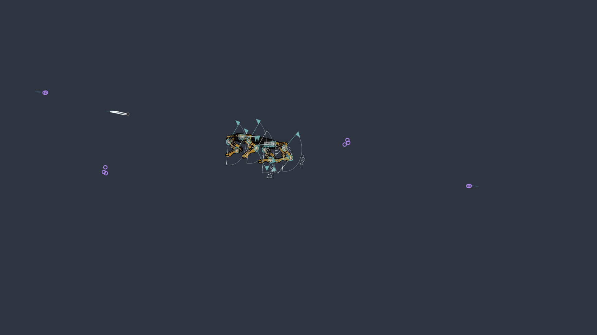

# robotdog — Robot Description



## Overview

| Property | Value |
|----------|-------|
| Total mass | 13.442 kg |
| Links | 14 |
| Joints | 13 (12 movable) |
| Assemblies | 1 |
| Root link | `base_link` |

## Table of Contents

- [Kinematic Tree](#kinematic-tree)
- [Link Properties](#link-properties)
- [Joint Properties](#joint-properties)
- [Assembly Breakdown](#assembly-breakdown)
- [Quick Start (ROS 2)](#quick-start-ros-2)
- [Files](#files)

## Kinematic Tree

```
base_link [BAKE]
  └─ Revolute_2 [revolute]
    HipFrontLeft_BackRight_f [BAKE]
      └─ Revolute_14 [revolute]
        robotdog_FemurL_f [BAKE]
          └─ Revolute_4 [revolute]
            TibiaR_f [BAKE]
  └─ Revolute_8 [revolute]
    HipFrontLeft_BackRight [BAKE]
      └─ Revolute_9 [revolute]
        robotdog_FemurR_f [BAKE]
          └─ Revolute_10 [revolute]
            robotdog_TibiaL_f [BAKE]
  └─ Revolute_11 [revolute]
    robotdog_HipFrontRight_BackLeft [BAKE]
      └─ Revolute_12 [revolute]
        robotdog_FemurR_f_2 [BAKE]
          └─ Revolute_13 [revolute]
            robotdog_TibiaL_f_2 [BAKE]
  └─ Rigid_15 [fixed]
    LowerSpine
  └─ Revolute_16 [revolute]
    robotdog_HipFrontRight_BackLeft_2 [BAKE]
      └─ Revolute_17 [revolute]
        robotdog_FemurL_f_2 [BAKE]
          └─ Revolute_18 [revolute]
            TibiaR [BAKE]
```

## Link Properties

| Link | Mass (kg) | Material | Collision | Bodies |
|------|-----------|----------|-----------|--------|
| `HipFrontLeft_BackRight` | 0.9284 | Steel | box | 2 |
| `HipFrontLeft_BackRight_f` | 0.9284 | Steel | box | 2 |
| `LowerSpine` | 2.5763 | Steel | box | 1 |
| `TibiaR` | 0.3957 | Steel | box | 1 |
| `TibiaR_f` | 0.3932 | Steel | box | 1 |
| `base_link` | 3.1121 | Steel | box | 1 |
| `robotdog_FemurL_f` | 0.4345 | Steel | box | 1 |
| `robotdog_FemurL_f_2` | 0.4345 | Steel | box | 1 |
| `robotdog_FemurR_f` | 0.8689 | Steel | box | 2 |
| `robotdog_FemurR_f_2` | 0.8689 | Steel | box | 2 |
| `robotdog_HipFrontRight_BackLeft` | 0.4642 | Steel | box | 1 |
| `robotdog_HipFrontRight_BackLeft_2` | 0.4642 | Steel | box | 1 |
| `robotdog_TibiaL_f` | 0.7864 | Steel | box | 2 |
| `robotdog_TibiaL_f_2` | 0.7864 | Steel | box | 2 |

## Joint Properties

| Joint | Type | Parent → Child | Axis | Limits |
|-------|------|---------------|------|--------|
| `Revolute_10` | revolute | `robotdog_FemurR_f` → `robotdog_TibiaL_f` | (0,0,1) | [-125.0°, 0.0°] |
| `Revolute_11` | revolute | `base_link` → `robotdog_HipFrontRight_BackLeft` | (0,0,1) | [-20.0°, 15.0°] |
| `Revolute_12` | revolute | `robotdog_HipFrontRight_BackLeft` → `robotdog_FemurR_f_2` | (0,0,1) | [-155.0°, -25.0°] |
| `Revolute_13` | revolute | `robotdog_FemurR_f_2` → `robotdog_TibiaL_f_2` | (0,0,1) | [-95.0°, 35.0°] |
| `Revolute_14` | revolute | `HipFrontLeft_BackRight_f` → `robotdog_FemurL_f` | (0,0,1) | [-75.0°, 60.0°] |
| `Revolute_16` | revolute | `base_link` → `robotdog_HipFrontRight_BackLeft_2` | (0,0,1) | [-30.0°, 20.0°] |
| `Revolute_17` | revolute | `robotdog_HipFrontRight_BackLeft_2` → `robotdog_FemurL_f_2` | (0,0,1) | [0.0°, 255.0°] |
| `Revolute_18` | revolute | `robotdog_FemurL_f_2` → `TibiaR` | (0,0,1) | [-5.0°, 120.0°] |
| `Revolute_2` | revolute | `base_link` → `HipFrontLeft_BackRight_f` | (0,0,1) | [-25.0°, 15.0°] |
| `Revolute_4` | revolute | `robotdog_FemurL_f` → `TibiaR_f` | (0,0,1) | [-35.0°, 95.0°] |
| `Revolute_8` | revolute | `base_link` → `HipFrontLeft_BackRight` | (0,0,1) | [-20.0°, 15.0°] |
| `Revolute_9` | revolute | `HipFrontLeft_BackRight` → `robotdog_FemurR_f` | (0,0,1) | [30.0°, 165.0°] |
| `Rigid_15` | fixed | `base_link` → `LowerSpine` | (0,0,1) | — |

## Assembly Breakdown

### robotdog

- **Links**: base_link, LowerSpine, HipFrontLeft_BackRight_f, robotdog_FemurL_f, TibiaR_f, HipFrontLeft_BackRight, robotdog_FemurR_f, robotdog_TibiaL_f, robotdog_HipFrontRight_BackLeft, robotdog_FemurR_f_2, robotdog_TibiaL_f_2, robotdog_HipFrontRight_BackLeft_2, robotdog_FemurL_f_2, TibiaR
- **Total mass**: 13.442 kg

## Quick Start (ROS 2)

```bash
# 1. Copy package to your ROS 2 workspace
cp -r robotdog_description ~/ros2_ws/src/

# 2. Build
cd ~/ros2_ws
colcon build --packages-select robotdog_description
source install/setup.bash

# 3. Visualize in RViz2
ros2 launch robotdog_description display.launch.py

# 4. Validate URDF structure
check_urdf install/robotdog_description/share/robotdog_description/urdf/robotdog.urdf

# 5. Print kinematic tree
urdf_to_graphviz install/robotdog_description/share/robotdog_description/urdf/robotdog.urdf
```

**Joint control**: The launch file includes `joint_state_publisher_gui` —
use the sliders to move revolute/prismatic joints in RViz2.

**Topic inspection**:
```bash
# See published joint states
ros2 topic echo /joint_states

# See robot description parameter
ros2 param get /robot_state_publisher robot_description
```

## Files

| Path | Description |
|------|-------------|
| `urdf/robotdog.urdf.xacro` | Top-level xacro (entry point) |
| `urdf/robotdog.urdf` | Flat URDF (for validation) |
| `urdf/assemblies/` | Per-assembly xacro macros |
| `meshes/` | Visual (OBJ) and collision (STL) meshes |
| `launch/display.launch.py` | Launch robot_state_publisher, RViz, and generated controllers |
| `config/joint_state.yaml` | Joint state publisher config |
| `config/ros2_controllers.yaml` | Generated ros2_control controller manager config |
| `robot_data.yaml` | Supplementary data (beyond URDF) |
| `docs/transforms.md` | Transformation matrices (KaTeX) |

## Customizing

Assemblies tagged `!dummy_` are designed to be swapped out. To replace one:

1. Create your replacement as a xacro macro with the same interface
2. Place it in `urdf/assemblies/`
3. Update the `<xacro:include>` in `urdf/robotdog.urdf.xacro`
4. Update meshes in `meshes/<your_assembly>/`

The xacro prefix system (`${prefix}`) ensures link names stay unique
when multiple instances of the same assembly are used.

---
*Generated by Fusion URDF/XACRO Exporter v3.1.1*